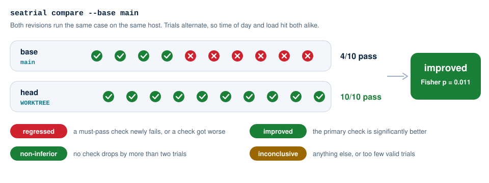
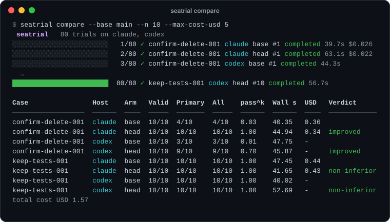

<!-- markdownlint-disable-next-line MD041 -->
<p align="center">
<picture>
  <source media="(prefers-color-scheme: dark)" srcset="https://raw.githubusercontent.com/otaviobarros/seatrial/main/docs/images/logo-dark.png">
  
</picture>
</p>

<p align="center">Sea trials for agent skills.</p>

<p align="center">
  <a href="https://github.com/otaviobarros/seatrial/actions/workflows/ci.yml"></a>
  
  
  <a href="https://github.com/otaviobarros/seatrial/blob/main/LICENSE"></a>
</p>

You changed a skill. Did the agent get better, or did it only feel better on the
one prompt you tried? seatrial answers that the way a shipyard tests a boat: it
takes the skill out on a fixed course, many times, and records what happened.

- **Real agents.** Each trial runs the actual CLI, Claude Code (`claude -p`) or
  Codex (`codex exec`), in a fresh project. Add other hosts through a small
  [adapter](https://github.com/otaviobarros/seatrial/blob/main/docs/hosts.md).
- **Graded by code.** A case's `grade()` checks files, Git state, commands, tool
  calls, and the final message. No model judges the result.
- **Two revisions, one verdict.** `compare` runs `main` against your uncommitted
  edits, or no skill against your skill, and reports `improved`, `non-inferior`,
  `regressed`, or `inconclusive`.
- **Nothing to install into your project.** Python 3.11+ standard library and Git.

## How it works

<picture>
  <source media="(prefers-color-scheme: dark)" srcset="https://raw.githubusercontent.com/otaviobarros/seatrial/main/docs/images/how-it-works-dark.svg">
  
</picture>

<details>
<summary>The five steps in text</summary>

Each trial runs these steps:

1. **Case.** `build()` in the case's `case.py` writes a small fictional project
   and returns the request a user would type.
2. **Mount.** seatrial mounts your skills at one revision, a Git ref such as
   `main` or the uncommitted `WORKTREE`, as a plugin.
3. **Agent.** The real host CLI (`claude` or `codex`) runs the request in a
   fresh, isolated folder.
4. **Evidence.** seatrial records the commands, file edits, tool calls, loaded
   skills, and final message in `evidence.json`.
5. **Grade.** `grade()` checks that evidence and the project, and returns pass or
   fail for each assertion in `case.toml`.

</details>

seatrial repeats each trial n times per case, host, and revision, and writes the
pass rates and verdicts to `summary.json`. Repetition turns one lucky run into a
pass rate.

## How seatrial compares

Other tools evaluate agents too. This table reflects their public documentation
in November 2026.

| | seatrial | [`claude plugin eval`](https://code.claude.com/docs/en/plugin-evals) | [promptfoo](https://www.promptfoo.dev/docs/guides/test-agent-skills/) | [Inspect](https://inspect.aisi.org.uk) + [inspect_swe](https://meridianlabs-ai.github.io/inspect_swe) |
|---|---|---|---|---|
| Agents | Claude Code and Codex CLIs; others through an adapter | Claude Code | Claude Agent SDK, Codex SDK, OpenCode SDK | Claude Code and Codex CLI as Inspect agents, with any model |
| Compares | Two Git revisions of your skills, including uncommitted edits, or a revision against no skill | The plugin loaded against no plugin | Skill versions in separate fixture folders, side by side | Models and agents on a task set |
| Grading | Your Python code over files, Git state, commands, and the final message | Regex, tool use, and file checks, plus model-judged rubrics | Assertions such as skill used, custom JavaScript, plus model-graded | Code or model scorers |
| Statistics | Fisher exact test per assertion, and a verdict per case and host | Three runs per case by default, mean scores against a threshold | `--repeat`; no significance test | Metrics such as accuracy and standard error |
| Isolation | Fresh Git project per trial, filtered environment, flags skills from outside the plugin | Fresh home, working folder, and config per run | A `working_dir` per provider | Docker sandbox |
| Runtime | Python 3.11+ standard library; no dependencies | Built into Claude Code 2.1.269+ | Node and the agent SDK packages | Python packages; Docker for the sandbox |

Choose seatrial to answer "did this skill edit make the agent better or worse"
on the real CLIs, with code-graded cases and a statistical verdict. Choose
`claude plugin eval` to check that a plugin helps compared with no plugin, inside
Claude Code. Choose promptfoo when your evals already live in promptfoo or need
model-graded rubrics. Choose Inspect for benchmark-scale runs in sandboxes or
across many models.

## Install

Run it with [uv](https://docs.astral.sh/uv/). `uvx` builds the package into a cached,
isolated environment and runs the command; nothing is installed into your project.

```sh
uvx seatrial --help                  # from PyPI
uvx --from . seatrial --help         # from a checkout
uv tool install seatrial             # keep `seatrial` on PATH
```

Without uv, use `pipx install seatrial`, or run `python3 -m seatrial`
with `src/` on `PYTHONPATH`. The package has no dependencies beyond Python 3.11+.

seatrial runs on macOS and Linux. Windows is not supported; use WSL.

## Quickstart

```sh
cd my-skills-project
seatrial init            # detect skills, write seatrial.toml and an example case
seatrial doctor          # check Python, Git, the configuration, cases, and host CLIs
seatrial list
seatrial run --dry-run   # print the trial plan; no model calls
seatrial run --host claude --n 1
seatrial                 # interactive mode on a terminal
```

`init` finds folders that hold `<name>/SKILL.md`. Two layouts work:

- `plugin`: a Claude Code plugin root with `skills/` and `.claude-plugin/plugin.json`.
- `skills`: a plain folder of skills. seatrial mounts it as a generated plugin.

On a terminal, `init` asks which folder, namespace, case folder, and hosts to use.
With `--yes` or without a terminal, it uses the detected values. See
[configuration](https://github.com/otaviobarros/seatrial/blob/main/docs/configuration.md) for every key.

## Commands

| Command | Does |
|---|---|
| `init` | Write `seatrial.toml` and a runnable example case |
| `doctor` | Check the environment; exits 3 when a check fails |
| `list` | List cases; accepts selectors |
| `new-case --skill S --id NAME-001` | Create a case skeleton; prompts on a terminal |
| `run [--rev REV]` | Run cases against one skill revision |
| `compare --base REV [--head REV]` | Run both revisions, interleaved, and give a verdict per case and host |
| `runs` | List retained run directories, newest first |
| `report [RUN_DIR\|latest]` | Print a run summary; `--format markdown` for a Markdown table, `--format comment` for a pull request comment or job summary, `--correction` to re-apply a method |
| `regrade [RUN_DIR\|latest]` | Grade retained trials again with the current case code; no host calls |
| `hosts` | List host adapters, models, and CLI versions |
| `schema` | Print the configuration, case, evidence, and exit-code contract |
| `interactive` | Menu-driven mode; also the default with no arguments on a terminal |

Every command except `interactive` accepts `--json`. `seatrial COMMAND --help` lists all options.
For agents and CI, read [using seatrial from an agent](https://github.com/otaviobarros/seatrial/blob/main/docs/agents.md).

## Agent skill

[`skills/seatrial`](https://github.com/otaviobarros/seatrial/blob/main/skills/seatrial/SKILL.md) teaches an agent to set up seatrial,
write cases, run and compare within a budget, and read the results. Install it with
the [skills](https://skills.sh) CLI:

```sh
npx skills add otaviobarros/seatrial
```

## Run and compare

`run` and `compare` call host CLIs and spend quota. Before a native run:

1. Sign in to each CLI (`claude /login`, `codex login`).
2. Print the plan with `--dry-run`. It loads every selected `case.py` and stops
   with exit 2 if one fails to import.
3. Set a budget: `--n`, `--max-runs`, `--max-minutes`, and `--max-cost-usd` for
   hosts that report cost.

A revision is a Git revision, `WORKTREE` (the skill files in the checkout with
uncommitted changes), or `NONE`. `compare` defaults `--head` to `WORKTREE`, so
`seatrial compare --base main` measures uncommitted edits. Each revision mounts
as a whole skill folder; trials alternate between revisions so that time and load
affect both alike.

`NONE` is the baseline without the skill: it mounts no plugin, and the prompt is
the case request without the skill invocation. `seatrial compare --base NONE`
measures whether the skill helps at all; text reports label that arm `none`, and
JSON keeps the arm name with `revisions.<arm>.name` set to `NONE`. A `NONE`
trial that loads any skill gets status `contaminated` and is not graded. `NONE`
is reserved: it cannot name a Git ref. Hosts that cannot run without a plugin
reject it.

Selectors combine and repeat: `--case ID`, `--skill NAME`, `--rule ID`,
`--suite capability|regression`, `--host NAME`. Cases marked `holdout = true` run
only with `--holdout`, so you can tune a skill on some cases and check it on
others; see [held-out cases](https://github.com/otaviobarros/seatrial/blob/main/docs/cases.md#held-out-cases).
Cases marked `trigger = "auto"` test whether the agent loads the skill on its
own; see [trigger modes](https://github.com/otaviobarros/seatrial/blob/main/docs/cases.md#trigger-modes).

<details>
<summary>Options, defaults, and limits</summary>

| Option | Default | Maximum |
|---|---|---|
| `--n` trials per case, host, and revision | `[run] n`, 3 | `[limits] max_n`, 10 |
| `--jobs` parallel trials | `[run] jobs`, 1 | `max_jobs`, 4 |
| `--max-runs` trials in the plan | `max_runs`, 100 | `max_runs` |
| `--max-minutes`; a trial starts only if its timeout fits | `max_minutes`, 90 | `max_minutes` |
| `--timeout` seconds per trial | case value, else `[run] timeout`, 180 | `max_timeout`, 600 |
| `--max-cost-usd` total host-reported cost | none | none |
| `--budget-usd` per-trial cap (Claude only) | none | none |
| `--trigger explicit\|auto`; `auto` sends the request without the skill invocation | case `trigger`, `explicit` | none |
| `--correction none\|holm\|bh`; adjusts Fisher p-values across the run | `none` | none |
| `--sequential` with `--looks 5,10`; `compare` only | off; looks every 5 trials up to `--n` | last look at most `max_n` |

</details>

A usage-limit or authentication error stops the run. Finished trials are kept,
and the command exits 1.

## Verdicts

<picture>
  <source media="(prefers-color-scheme: dark)" srcset="https://raw.githubusercontent.com/otaviobarros/seatrial/main/docs/images/compare-dark.svg">
  
</picture>

`compare` gives each case and host one advisory verdict:

| Verdict | Meaning |
|---|---|
| `regressed` | A zero-tolerance assertion newly fails, or an assertion is significantly worse (Fisher p < 0.05) |
| `improved` | The primary assertion is significantly better, and head has no zero-tolerance failure |
| `non-inferior` | No assertion drops by more than two trials' worth |
| `inconclusive` | Otherwise, or fewer than 80% of the trials in a revision are valid |

Ten trials per revision detect only changes of about 60 percentage points on
the primary assertion, and none from a 50% pass rate; 30 trials detect about 30
points. With 3 trials, `improved` is not possible. Report a
non-significant result as "no detected effect". The report also shows pass^k,
median lines added, mean wall time, and host-reported cost. Use
`--fail-on-regression` to exit 4 on any `regressed` verdict.

Each primary pass count comes with its 95% Wilson interval, for example
`7/10 (40–89%)`: the range of true pass rates that fit the trials. Wide or
overlapping intervals mean the run is too small to tell the revisions apart.
Each verdict also comes with a reading: the evidence behind it, why it holds, and,
when the result is undecided, how many trials per revision would decide it.
`summary.json` stores the reading as fields under `interpretation`.
[Statistics](https://github.com/otaviobarros/seatrial/blob/main/docs/statistics.md)
explains the method and how to read it.

`--format comment` on `run`, `compare`, or `report` prints Markdown for a pull
request comment on any platform: one line per verdict count, then the regressed
and inconclusive cases, then the full table in a collapsed block. Progress goes
to stderr, so stdout holds only the Markdown. `--summary-file PATH` also appends
that Markdown to a file, such as a CI job summary.
[Continuous integration](https://github.com/otaviobarros/seatrial/blob/main/docs/ci.md)
has recipes for GitHub Actions, GitLab CI, Azure Pipelines, and any other platform.

### Many cases at once

Each verdict tests every assertion at p < 0.05. A run with 20 cases and 3
assertions makes 60 tests, and each test can give a false `regressed` or
`improved` verdict up to 5% of the time when nothing changed, so false verdicts
add up as cases grow. `--correction` adjusts the p-values across the run's
Fisher tests before the verdict rules apply:

| Value | Controls | Choose it when |
|---|---|---|
| `none` | Nothing; each test at p < 0.05 (default) | Few cases, or you read verdicts by hand |
| `holm` | The chance of any false verdict in the run | `--fail-on-regression` gates CI on a small, stable suite |
| `bh` | The share of false verdicts among the significant ones | Many cases, screening for where to look |

The family leaves out tests that cannot reach p < 0.05 with their pass counts,
such as 10/10 against 10/10; they keep their raw p-value. Zero-tolerance
failures and decisions with too few valid trials have no p-values, stay outside
the family, and keep their verdict under every method. A verdict the correction changed shows `*`, and `summary.json` keeps
it as `verdict_uncorrected`. `seatrial report --correction holm` applies a
method to a stored run without new trials. Cases whose two runs of the same
revision often disagree need a stricter method, or more trials.

### Stop early when the verdict is clear

`compare --sequential --looks 5,10` runs trials in batches. After each look,
it checks every case and host on all trials so far and stops the ones that are
decided:

| Stop reason | When |
|---|---|
| `zero_tolerance` | A zero-tolerance assertion newly fails |
| `significant` | A Fisher test passes the per-look threshold |
| `futility` | Even if the remaining trials all went one way, no Fisher test could pass the threshold |
| `max_n` | The last look |

Undecided cases get the next batch, so trials go where the result is still
open. Each look tests at 0.05 divided by the number of looks (0.025 for
`5,10`), which keeps the chance of a false verdict at or below 0.05 across all
looks. A case that stops early is judged on its trials so far, but its
non-inferiority margin stays at the planned `--n`. A `futility` stop gives up
the trials in which a rare zero-tolerance failure might still have appeared;
use a fixed `--n` for cases where that matters.

`--correction` applies on top of the per-look threshold. With `holm` or `bh`,
a case stops as `significant` only when its p-value passes the per-look
threshold divided by the number of assertions in the run, so the corrected
verdict keeps the stop. A budget, deadline, or stopping error ends the run
without judging the unfinished look; those trials count as skipped, not saved.

<p align="center">
  
</p>

## Results

Each invocation writes a run directory under `[run] state_dir` (default
`$SEATRIAL_STATE`, else `~/.cache/workspaces/<timestamp>/`). The path prints at
the end of the run. Keep it out of version control. Projects can share a state
directory: `runs`, `report latest`, and `regrade` show only the current project's runs.

<details>
<summary>Files in a run directory</summary>

| File | Content |
|---|---|
| `run.json` | The run settings and revisions, including `trigger_override`, written before the first trial |
| `records.jsonl` | One record per trial, written as each trial ends; `foreign_skills`, `unknown_skills`, and `outside_access` mark trials that used skills from outside the plugin, read a skill whose source the trace cannot show, or named the project path; `trigger` is the trial's trigger mode (`auto` for NONE), and `other_skills` lists other plugin skills it loaded, by resolved path |
| `summary.json` | Per-case, per-host, per-revision summaries with 95% pass-rate intervals, and verdicts with their `interpretation`; missing when the run was interrupted, until `seatrial regrade` builds `summary-regraded.json` |
| `trials/<random>/` | The trial project, `session.jsonl` trace, `stderr.txt`, `evidence.json`, `retained.json` |

</details>

Trial directories use random names so that no path the agent sees names the
evaluation. Private host state, including any copied login, is removed after each
trial.

<details>
<summary>Trial statuses</summary>

Only `completed` trials are graded. Other statuses are excluded from pass rates:

| Status | Meaning |
|---|---|
| `control` | The grader marked the trial as a control, not a measurement |
| `trace_incomplete` | The agent delegated, but at least one delegated session was not captured |
| `usage_limit`, `auth_error` | Host quota or sign-in problem; the run stops |
| `timeout`, `host_stall` | The time cap ended the trial; `host_stall` means the machine paused |
| `incomplete` | The host exited without a successful final turn |
| `harness_error` | seatrial failed; the record holds the exception |
| `contaminated` | A `NONE` trial loaded a skill, so it does not measure running without one |
| `stale` | From `regrade` only: the retained project files or `evidence.json` changed after the trial |

</details>

`regrade` writes `records-regraded.jsonl` and `summary-regraded.json`. Copy
retained trial files before you inspect them with tools that write.

## Documentation

- [Configuration](https://github.com/otaviobarros/seatrial/blob/main/docs/configuration.md): `seatrial.toml` keys and defaults.
- [Writing cases](https://github.com/otaviobarros/seatrial/blob/main/docs/cases.md): `case.toml`, `case.py`, evidence, and grading helpers.
- [Hosts](https://github.com/otaviobarros/seatrial/blob/main/docs/hosts.md): built-in adapters and how to add one.
- [Using seatrial from an agent](https://github.com/otaviobarros/seatrial/blob/main/docs/agents.md): JSON output, exit codes, and a safe procedure.
- [Statistics](https://github.com/otaviobarros/seatrial/blob/main/docs/statistics.md): how verdicts, intervals, and trial estimates work, and how to read them.
- [Continuous integration](https://github.com/otaviobarros/seatrial/blob/main/docs/ci.md): pull request comments, job summaries, and gates on any platform.

## License

MIT. See [LICENSE](LICENSE).
